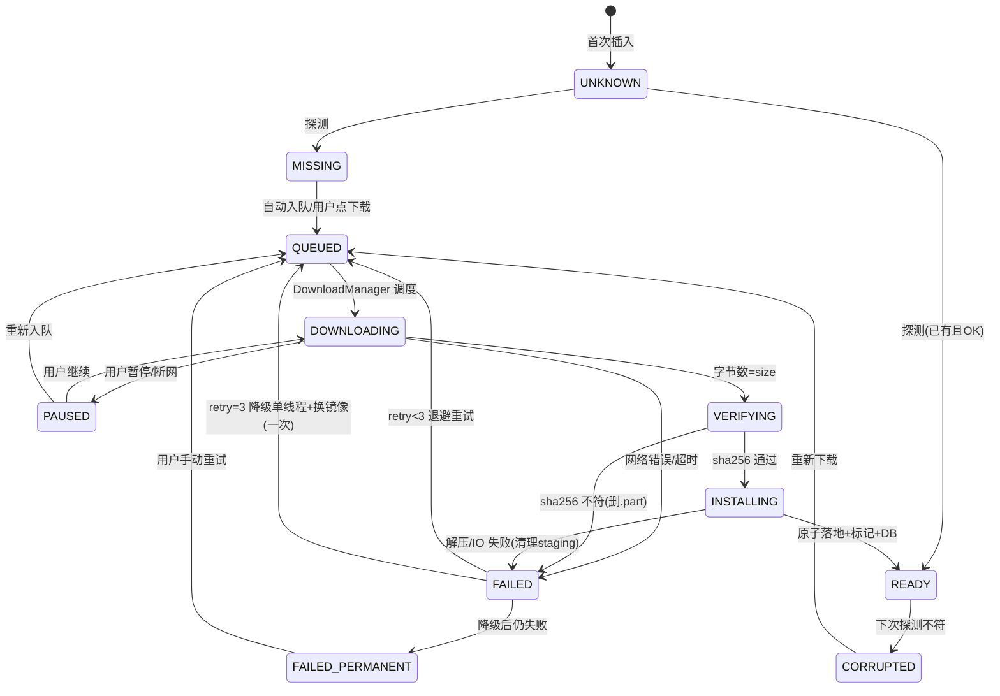

# Step 0 设计：core-env（环境探测与自动补齐）

> 状态：待评审（未写代码）。评审通过后按本设计实现 core-env 模块。
> 交付物对应：EnvProbe 单测、状态机图、映射表、手工验证步骤。

---

## 0. 目标与范围

- 首次启动（及每次启动）自动探测 JRE / natives / assets 索引三项环境，输出汇总 `EnvState = MISSING | PARTIAL | READY | CORRUPTED`。
- 缺失项自动进入下载队列（复用 core-download 的 DownloadManager），全程进度可见、可暂停/续传/后台，SHA 校验失败自动重试（3 次 → 降级单线程 → 换镜像），校验通过才写「就绪标记」。
- 未就绪（按当前 Profile 的依赖集判定）不允许进入游戏。
- 环境层幂等：重复执行探测/补齐不产生副作用；JRE 可后续手动升级且不影响旧 Profile。
- 本期范围：JRE 17（1.20.1 轨）+ JRE 21（1.21.x 轨）；JRE 8 只保留映射表与目录约定，不预下载。

---

## 1. 组件与目录契约

沿用既定存储布局，core-env 只新增「标记文件」这一种新对象，其余全部落 DB：

| 对象 | 位置 | 说明 |
|---|---|---|
| JRE | `files/env/jre/<javaVer>/arm64/` | 17/21 多版本共存；解压自上游 tar.xz |
| JRE 就绪标记 | `files/env/jre/<javaVer>/arm64/.build` | 内容：`buildId=...` `sha256=...` `javaVersion=17.x`；与 DB EnvItem 双写互证 |
| natives | `files/env/natives/<hash>/` | 全局池化，hash = 版本 json natives 集合内容哈希 |
| natives 标记 | `files/env/natives/<hash>/.complete` | 空文件即可；安装完成前不出现 |
| assets 索引 | `files/runtimes/<profileId>/versions/<id>/assets/indexes/<indexId>.json` | 探测只查索引文件本身 |
| 下载中间产物 | `files/downloads/tmp/<taskId>.part` | 断点续传载体；启动时幂等清理（见 §5） |
| 解压暂存 | `files/downloads/tmp/<taskId>.staging/` | 与目标同分区，rename 原子落地 |
| DB | `files/launcher.db` | EnvItem / DownloadTask / lockfile 等（Room，M1 建表） |

**为什么不把「就绪」只放 DB 或只放文件标记**：进程被杀时二者都可能滞后，因此「探测」（文件+运行态）永远是事实源，DB/标记只是缓存加速；不一致时以探测结果为准并回写 DB（幂等自愈）。

---

## 2. EnvProbe 探测矩阵

`EnvProbe.probe(scope: EnvScope): EnvProbeReport`，其中 EnvScope 由「当前选中 Profile」派生（JRE major + natives hash + assets index id）。探测项：

### 2.1 JRE 探测（每个 javaVer ∈ {17, 21}）

**静态检查**（无 exec，仅文件系统）：
1. `bin/java` 存在且大小 > 0；
2. `lib/arm64/libjli.so` 存在；
3. `lib/arm64/server/libjvm.so` 存在（Server Compiler 标志）；
4. `release` 文件存在且含 `JAVA_VERSION` 行。

**动态检查**（exec，15s 超时，环境变量 `LD_LIBRARY_PATH=<jre>/lib/arm64:<jre>/lib`、`HOME/TMPDIR` 指向 app files）：
1. 执行 `java -version`，**解析 stderr**（OpenJDK 传统上版本信息输出到 stderr，Android 构建亦然）；
2. 正则提取：
   - `openjdk version "(\d+)(?:\.(\d+))?(?:\.(\d+))?"` → major/minor；
   - `(64-Bit|32-Bit)` → 位宽（32-Bit 直接判 NOT_64BIT）；
   - `(Server VM|Client VM|Zero VM)` → 编译器类型（要求 Server）；
3. 一致性校验：解析出的 major 必须等于目录声明的 javaVer（17 目录跑出 21 → CORRUPTED / VersionMismatch）。

**单探针结果** `JreProbeResult`：
`Ok(major, minor, bits, vm)` | `Missing` | `Partial(missingFiles)` | `ExecFailed(errno, stderr)` | `WrongVersion(expected, actual)` | `Not64Bit` | `NoServerCompiler`

> 解析器设计为**宽松正则 + 严格断言**：正则容忍输出格式差异（用 golden 输出集回归），断言（major/位宽/Server）不放松。

### 2.2 natives 探测

- `env/natives/<hash>/.complete` 存在 && 目录条目数 > 0 → Ok；
- 目录不存在 → Missing；目录存在但无标记/为空 → Partial；
- 抽查：version json 中 natives 声明的首个 `.so` 存在且大小 > 0（防止目录被清空但标记残留）。
- 完整性全量校验在 core-download 安装期做（逐文件 SHA-1），探测不重复全量哈希（大目录，代价高）。

### 2.3 assets 索引探测

- `assets/indexes/<indexId>.json` 存在、大小 > 0，且其内容 SHA-1 == version json 中 `assetIndex.sha1` → Ok；
- 无文件 → Missing；有文件但哈希不符 → Corrupted；
- **默认不遍历 `objects/` 全量文件**（GB 级，探测 O(n) 不可接受）。全量资源 SHA-1 校验在 core-download 下载后逐文件执行；「进入游戏」门禁以「assets 下载任务 READY」为准（见 §6）。

### 2.4 EnvState 合成规则

对 Profile 依赖集内所有组件取最坏状态：

| 合成规则 | EnvState |
|---|---|
| 全部 Ok | **READY** |
| 存在 Missing（任何组件完全不存在） | **MISSING** |
| 存在 Partial（有文件但不可用） | **PARTIAL** |
| 存在 ExecFailed / WrongVersion / Not64Bit / NoServerCompiler / 哈希不符 | **CORRUPTED** |

优先级 CORRUPTED > PARTIAL > MISSING（报告里带 `reasons: List<EnvIssue>` 明细，UI 逐条展示）。初装设备（无任何组件）为 MISSING，属正常首启状态，不报错。

---

## 3. 状态机

### 3.1 单组件任务状态机（EnvItem 持久化）



- 转移全部落 DB（`EnvItem.state` + `errorCode` + `retryCount`），**状态机不驻留内存** → 进程被杀后重启即恢复。
- 退避：1s / 4s / 16s（协程 delay，可取消）；第 3 次失败后降级为单线程 + 切换镜像源再给一次机会，仍失败 → FAILED_PERMANENT（UI 显示「手动重试」）。
- 暂停语义：写盘 `progressBytes`，取消网络调用，`.part` 保留。
- PENDING_SWAP（JRE 升级特有）：新 build 已就绪但该 javaVer 被运行中进程占用（lockfile）→ 进程退出后自动 swap 或下次启动时 swap。

### 3.2 汇总门禁

`LaunchGate.isLaunchAllowed(profile) = ∀ profile 依赖组件 state == READY`。UI 订阅 Room Flow，不满足时「启动游戏」置灰，点击/长按可展开缺项明细。

---

## 4. 版本 ↔ JRE 映射表

**解析优先级**：
1. version json 的 `javaVersion.majorVersion` 字段（1.17+ 均有，权威来源）；
2. 缺省时查内置区间表；
3. 仍未知 → 默认 8（老版本惯例），但首轮仅 1.20.1/1.21.x，实际不会走到。

| MC 版本区间 | Java major | 说明 |
|---|---|---|
| ≤ 1.16.5 | 8 | 本期不预下载，映射保留 |
| 1.17 | 17 | 官方要求 16，社区无 16 移动构建，统一 17（UI 注明） |
| 1.18 – 1.20.4 | 17 | 含首轮目标 1.20.1 |
| ≥ 1.20.5 | 21 | 含首轮目标 1.21.x |

- Profile 只记录 `javaMajor`（8/17/21），**不绑定 buildId** → 升级 JRE（换 build）对旧 Profile 透明；旧 Profile 照常使用同 major 的新 build。
- JRE 升级流程：下新版 → staging 校验 → 无进程占用则 rename 原子替换 + 重写 `.build` → 有占用则 PENDING_SWAP。旧 build 文件在 swap 成功后删除；**绝不做半替换**。
- 版本选择 UI：选中版本即显示「需要 Java 17（已就绪）/ 需要 Java 21（一键补齐）」。

---

## 5. 幂等与断点恢复策略

### 5.1 下载（复用 core-download，本节只定义 core-env 侧的约定）

- 载体：`downloads/tmp/<taskId>.part`；DB 记录 `size`、`sha256`、`etag`、`lastModified`、`progressBytes`（每 512KB 刷盘一次，不追求字节级精确）。
- 续传：重连时发送 `Range: bytes=<partSize>-`，带 `If-Range: <etag>`；上游已变更（ETag 不符 / 416）→ 删 `.part` 从头下。这保证「断点续传」和「上游更新感知」二者兼得。
- 校验：下载完成后整包流式 SHA-256 与清单比对；失败 → 删 `.part`、retryCount+1 → QUEUED。
- 镜像：JRE 与 MC 资产共用 core-download 的镜像链框架（官方/BMCLAPI/Gitee + 测速回切）；**JRE 的镜像源见 §7 与待决策问题 Q1**。

### 5.2 安装（原子性）

1. 解压 xz+tar 到 `<taskId>.staging/`（与目标同分区）；
2. 静态检查（§2.1 的关键文件）+ 执行一次 `java -version` 冒烟（防「文件全但跑不起来」）；
3. `fsync` staging → `rename` 到最终目录（原子）→ 写 `.build` → DB 置 READY。
4. 任何一步失败：删 staging，状态 FAILED，**最终目录保持原状**（升级场景旧版本不受影响）。

### 5.3 启动时清理（幂等 reconcile）

启动序列（EnvBootstrap 入口，永远先于任何 UI 交互）：

```
1. 扫描 downloads/tmp：
   - .part 有对应 EnvItem 且状态 ∈ {QUEUED, DOWNLOADING, PAUSED, FAILED} → 保留，状态复位为 QUEUED（续传）
   - .part 无 DB 记录 / 对应任务已 READY / FAILED_PERMANENT → 删除（脏残留）
   - .staging 一律删除（解压无断点意义，重下重装成本 < 状态一致性成本）
2. 探测（§2）→ 与 DB/标记 reconcile：
   - 文件 OK 但 DB 非 READY → 回写 READY（自愈）
   - 文件异常但 DB READY → 置 CORRUPTED → QUEUED（自动重新下载）
3. 有 QUEUED 任务 → 按设置决定立即续传或等用户确认（默认：Wi-Fi 下自动续，蜂窝下询问）
```

### 5.4 崩溃恢复矩阵（进程被杀 / 断网 / 重启）

| 被杀时点 | 磁盘状态 | 重启后动作 |
|---|---|---|
| 下载中 | `.part` + DB progressBytes | 步骤 1 规则 → QUEUED → Range 续传 |
| 校验中 | 完整 `.part` | 重新校验（流式，无重复下载） |
| 解压中 | staging 半成品 | 删 staging → QUEUED 重下（或重解压，首版取重下，简单且正确） |
| rename 后、写标记前 | 完整目录、无 `.build` | 探测 OK → 补写标记 → READY |
| swap 前 | 新旧两目录 | 探测为准，重做 swap（幂等） |

设计原则：**文件系统的每次突变都先/后配一条 DB 记录；能由探测推断的状态绝不依赖「上次执行到哪一步」的内存。**

---

## 6. UI 状态卡片（首页顶部）

| 汇总态 | 卡片文案 | 明细行示例 | 可操作 |
|---|---|---|---|
| 探测中 | 正在检测运行环境… | — | — |
| MISSING | 缺少 Java 17 | Java 17：未安装 [下载] | 下载/一键补齐 |
| 下载中 | Java 17 下载中 43% | 进度条 + 速度 + ETA | 暂停/取消 |
| 校验/安装 | 正在校验并安装… | — | 取消 |
| READY | 环境就绪 ✓ | Java 17 ✓ / Java 21 ✓ / natives ✓ / assets ✓ | 重新校验（菜单） |
| CORRUPTED | 环境损坏：版本不符 | 原因逐条 + [重新下载] | 重新下载 |
| FAILED_PERMANENT | 下载失败（重试 3 次） | 错误码 + 镜像状态 | 手动重试 / 切换镜像 |

- 版本选择页：显示该版本所需 Java 与当前状态，「一键补齐」直接入队。
- 设置页「环境管理」（本期简版入口）：组件版本/buildId/占用空间/重新校验/升级检查。

---

## 7. 许可与上游事实核查（重要）

已核查（2026-11-01，[GitHub Releases 接口](https://api.github.com/repos/PojavLauncherTeam/android-openjdk-build-multiarch/releases) 与 [仓库页](https://github.com/PojavLauncherTeam/android-openjdk-build-multiarch)）：

- **JRE8**：[`jre8-arm64-20220811-release.tar.xz`](https://github.com/PojavLauncherTeam/android-openjdk-build-multiarch/releases/download/jre8-40df388/jre8-arm64-20220811-release.tar.xz)，27,509,232 B，Release 资产（不可变）。
- **JRE17**：[`jre17-arm64-20210825-release.tar.xz`](https://github.com/PojavLauncherTeam/android-openjdk-build-multiarch/releases/download/jre17-ec28559/jre17-arm64-20210825-release.tar.xz)，38,065,004 B，Release 资产（不可变），FCL/Pojav 社区长期验证。
- **JRE21**：该仓库 **没有 JRE21 的 Release 资产**，构建产物在 Actions 制品（buildjre17-21 分支）中，GitHub Actions 制品下载需要中转（如 nightly.link）或社区镜像站（如 [next.foldcraftlauncher.cn](https://next.foldcraftlauncher.cn) 系、klpbbs 开源镜像站）。→ 列入待决策问题 Q1。
- **许可**：OpenJDK（含 Pojav 移动端 fork）为 **GPLv2 + Classpath Exception**；PojavLauncher 本体 GPLv3。与本项目（GPL-3.0）兼容，但必须随 App 分发 GPLv2+CE 许可证文本、ABOUT 页列出组件与源码链接（硬性约束 4）。JRE 是独立 GPL 软件、**不属于 Minecraft 资产**，运行时下载分发不违反硬性约束 1（不打包 MC 本体），但 ABOUT 必须提供其源码获取途径。
- 接入时将对所选 build 实际下载并计算 SHA-256，写死进应用内置清单（信任源策略见 Q2）。

---

## 8. 验证计划（模块交付时执行）

**单测（JVM，无设备）**：
1. `JreVersionParser` 矩阵：8/17/21 正常输出、`21.0.3` 三段版本、`17-internal`、32-Bit、Zero VM、无 Server、乱码输出、空输出 —— 断言解析结果与错误分类。
2. FSM 全转移：正常链、暂停/继续、retry 1/2/3、降级单线程、FAILED_PERMANENT、CORRUPTED→QUEUED、PENDING_SWAP。
3. reconcile 矩阵：§5.4 六种被杀时点 × DB/标记组合 → 重启后期望状态。
4. 映射表：json `javaVersion` 优先、缺省区间、1.17→17、未知→8。
5. 清理规则：.part/.staging × DB 状态组合矩阵。

**手工（真机，arm64，Android 10+）**：
1. 全新安装 → 环境卡片出现「缺少 Java 17」→ 下载 → 进度 → 就绪；启动按钮从置灰变可用。
2. 下载中开飞行模式 → 卡片转暂停/失败 → 恢复网络 → 从断点继续（观察 Range 请求与已下载字节不回退）。
3. 人为改坏 `libjvm.so` → 重启探测 → CORRUPTED（NoServerCompiler）→ 自动重下 → 就绪。
4. 下载中杀进程 → 重启 → 断点继续，无残留脏 tmp。
5. 1.20.1 与 1.21.x 双 Profile：Java 17/21 并存，各自可启动（core-launch 就绪后联测）。
6. JRE 升级：替换 build → 旧 Profile 无需任何改动仍可用。
7. 手动升级入口：设置 → 环境管理 → 升级检查（模拟新 build）。

---

## 9. 已知问题与风险

1. **JRE21 分发链路不稳**（无官方 Release 资产）→ 已决策：借社区镜像站/中转分发（Q1），实现期锁定具体可用 URL 并做可用性监控；sha256 全量 pin 保证内容正确性。
2. 个别 ROM 将 `/data` 挂为 noexec → exec 失败判 CORRUPTED(ExecFailed)，提示设备不支持；需真机抽样验证比例。
3. `java -version` 输出格式随构建有差异 → 宽松正则 + golden 输出回归。
4. 首次 assets 全量可达 GB 级 → 必须前台 Service + 通知（Android 10+ FGS、Android 13+ 通知运行时权限），下载策略见 Q4。
5. GitHub 直连在国内网络环境慢/不可达 → 镜像链属 core-download，但 JRE 的镜像候选与 MC 资产不同，需单独维护清单。
6. 升级 swap 期间若被杀：新旧目录并存 → 幂等重做（§5.4 末行），无数据损坏窗口。

---

## 10. 决策记录（2026-11-01 已确认）

| # | 决策项 | 结论 |
|---|---|---|
| Q1 | JRE 上游与分发 | Pojav 预构建；8/17 走不可变 Release 资产，21 借社区镜像站/中转分发；sha256 全量 pin 强校验兜底 |
| Q2 | 校验清单信任源 | 应用内置清单 + 随发版更新 |
| Q3 | 补齐粒度 | 按当前 Profile 懒补齐 |
| Q4 | 下载调度 | 默认仅 Wi-Fi、可手动切任意网络；前台服务通知为硬需求 |
| Q5 | 项目标识 | 项目名 ACL-PE；包名 `org.aclpe.aclpe`；仓库 https://github.com/yemao-maomao/All-Craft-Launcher-PE |

**新待决策**：执行顺序调整——Step 0 代码需 Gradle 骨架（Step 1）支撑、EnvBootstrap 复用 Step 2 的下载模块，建议 1→0→2（见评审回复）。**已确认并执行完毕。**

---

## 11. 实现记录（2026-11-01，已交付）

### 11.1 设计 → 代码映射

| 设计条目 | 实现 |
|---|---|
| §2.1 JRE 静态+动态探测 | `EnvProbe.probeJre`：静态四文件检查 + `java -version`（15s 超时）经 `ProcessExecutor` 注入执行 |
| §2.2/2.3 natives / assets 探测 | `probeNatives`（标记+抽查 .so）/ `probeAssetsIndex`（SHA-1 流式比对） |
| §2.4 EnvState 合成 | `EnvProbeReport.state`（CORRUPTED > PARTIAL > MISSING > READY）+ `issues` 明细 |
| §3.1 状态机 | `EnvStateMachine`（纯函数：probe 绝对覆盖 / 重试 1-3 退避、第 3 次降级、第 4 次 FAILED_PERMANENT、手动重试清零）+ 全转移矩阵测试 |
| §4 映射表 | `JreVersionMapping`（json 优先 → 区间表 → 默认 8） |
| §5.1 下载契约 | `DownloadScheduler` 接口（Step 2 实现，硬性要求写入 KDoc）；`EnvBootstrap` 只依赖该接口 |
| §5.2 安装 | 本步不实现（属 Step 2 调度器职责），状态机已预留 VERIFYING/INSTALLING |
| §5.3 幂等清理 | `TmpCleaner`（.staging 全删 / .part 在途保留）+ `EnvBootstrap.cleanupTmp` |
| §5.4 恢复 | 状态全落 Room（`EnvItemEntity`/`EnvStore`）；`reconcile` 幂等且跳过在途任务（不打断续传） |
| §6 UI 卡片 | `HomeViewModel` + `HomeScreen` 环境卡片（探测/状态/按钮/门禁置灰），`Step2PendingDownloadScheduler` 诚实占位 |

### 11.2 与设计的偏差（均有理由）

1. **快照版本映射细化**：数字前缀可解析的快照按版本族映射（`21w14a` → 21），真正无法解析（`rd-132211`）才默认 8 —— 比「一律 8」更正确。
2. **ProbePartial 按 MISSING 处理**：安装是原子的（staging→rename），无增量价值，重新下载即可。
3. **位宽 UNKNOWN 判 Not64Bit**：宁可重下，不可误启动（设计文档 §2.1 已声明该取舍）。
4. **reconcile 跳过在途状态**（QUEUED/DOWNLOADING/PAUSED/VERIFYING/INSTALLING）：保证幂等且不打断断点续传。
5. **下载规格由调用方注入**（`Map<String, EnvDownloadSpec>`）：url/sha256 属 core-download 的清单职责（Step 2）；无规格时组件置 MISSING + `errorCode=no_download_spec`，UI 诚实提示。
6. **Room 2.8.5 无 File 重载** → 数据库路径用绝对路径字符串落 `files/launcher.db`；KSP 2.3.12（独立版本线，与 Kotlin 2.4.10 组合经 fork 实证）。

### 11.3 验证结果

- **单测：71/71 全绿**（0 failures / 0 errors）：core-common 16（既有）+ core-env 55（解析器矩阵 11、探测器矩阵 16、状态机 8、映射 7、tmp 清理 5、Bootstrap 5、门禁 4）。
- **构建**：`testDebugUnitTest` + `:app:assembleDebug` BUILD SUCCESSFUL（零警告）；APK 31.4MB（含 Room/KSP 产物），SHA256 `AC2088F7ADDB89D6820DF17CA129E2256007C1567B9FDA57EEB090A295509404`。
- **手工步骤（真机）**：
  1. 安装 `dist/app-debug.apk` → 首页卡片显示「Java 17：未安装」「Java 21：未安装」+ 总状态「未安装」；启动按钮置灰；点「下载」出现「下载能力将在 Step 2 接入」。
  2. `adb shell run-as org.aclpe.aclpe` 创建 `files/env/jre/17/arm64/{bin/java,lib/arm64/server/libjvm.so,lib/arm64/libjli.so,release}`（java 用能 echo `openjdk version "17.0.5"` 与 `64-Bit Server VM` 的 shell 脚本）→ 点「重新检测」→ 卡片该行变「✓ 就绪」（若 exec 失败会显示「损坏」，即为 CORRUPTED 路径验证）。
  3. 杀进程重启 App → 卡片状态不变（Room 持久化恢复）。
  4. `files/logs/launcher.log` 存在且无 token 明文。

### 11.4 已知问题

1. `RealProcessExecutor` 尚未在真机验证（真机 exec JRE 属 Step 2 下载完成后；手工步骤 2 覆盖此路径）。
2. `.part` 文件名 `':'→'_'` 转换：组件键含 `_` 时回转换引入 `':'`；当前键集（`jre:17`、hex hash、hex indexId）均无 `_`，实际无影响（TmpCleaner 注释已注明取舍）。
3. 骨架期探测范围固定 JRE 17/21；natives/assets 的 EnvScope 注入由 Step 2 在版本安装后提供。
4. `Step2PendingDownloadScheduler` 为诚实占位（非假实现），Step 2 替换。
5. Room `exportSchema=false`（骨架期）；CI/迁移管理阶段再启用 schema 导出。
